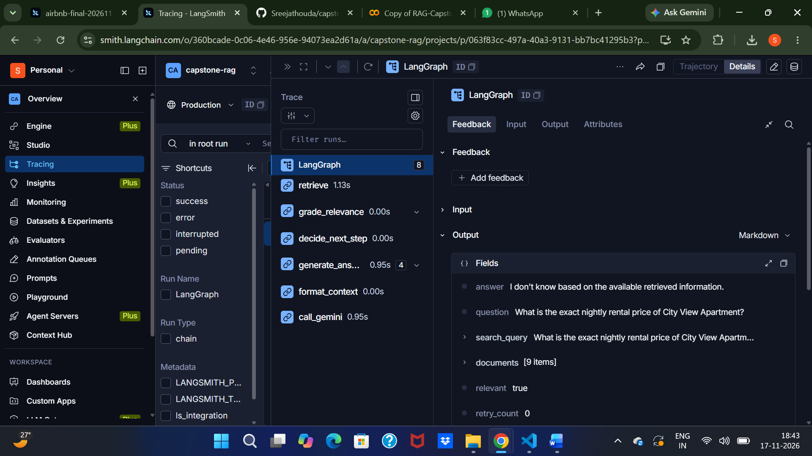
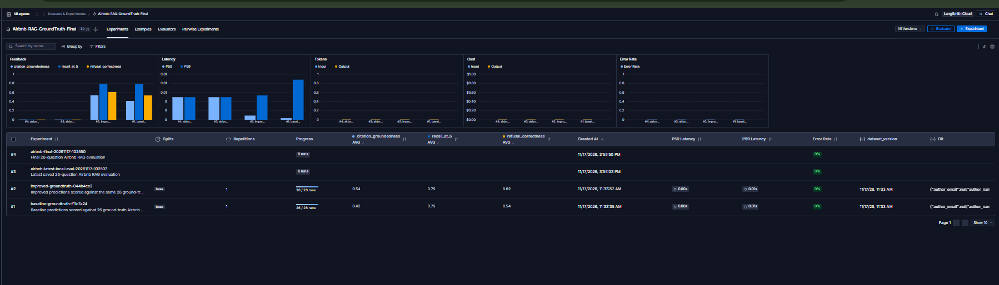
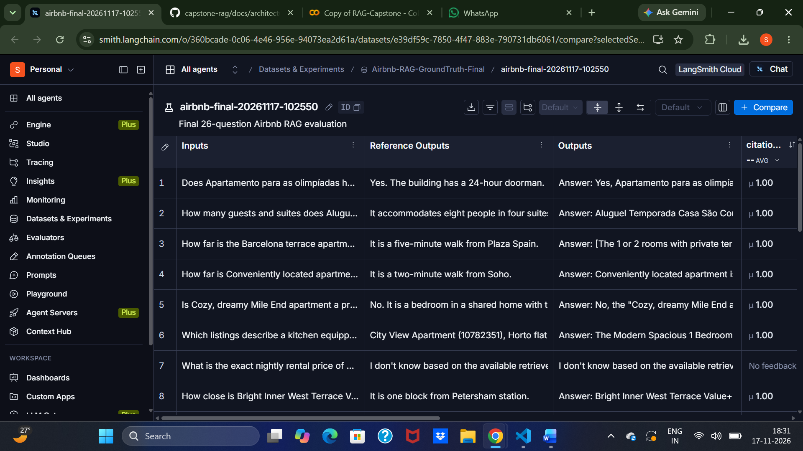
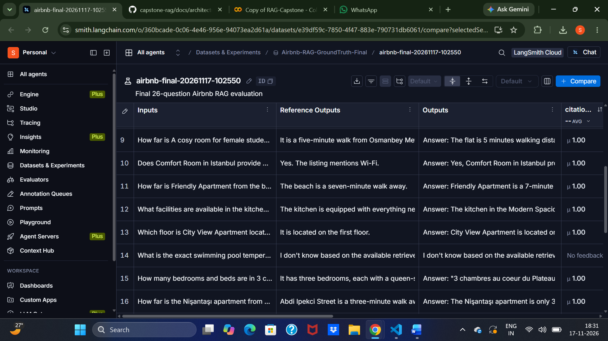
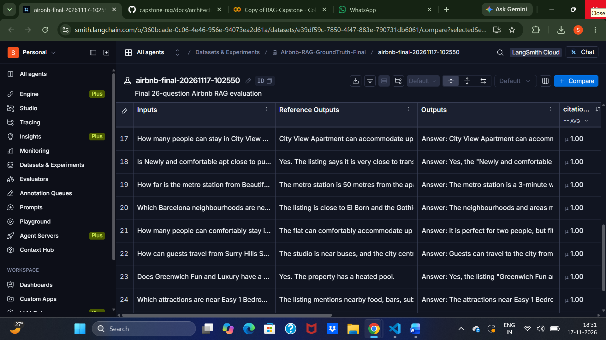
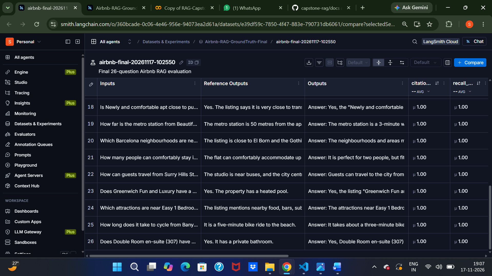

# Airbnb Self-Correcting RAG Agent

## 1. Project Overview

This project implements a Retrieval-Augmented Generation (RAG) agent over the MongoDB Airbnb listings dataset.

The system retrieves relevant Airbnb listing information, evaluates the relevance of retrieved documents, rewrites the query when necessary, and generates answers grounded in retrieved evidence.

If sufficient information is unavailable, the agent returns a refusal instead of generating an unsupported answer.

## 2. Tech Stack

- Python
- LangChain
- LangGraph
- LangSmith
- MongoDB Atlas
- MongoDB Atlas Vector Search
- Sentence Transformers (`all-MiniLM-L6-v2`)
- Google Gemini (`gemini-3.5-flash-lite`)

**Note:** The assignment specified OpenAI embeddings (`text-embedding-3-small`) and an OpenAI chat model. This implementation uses Sentence Transformers and Google Gemini instead. Therefore, the OpenAI-specific requirement is not yet satisfied.

## 3. Dataset

Source database: `sample_airbnb`

Source collection: `listingsAndReviews`

The project processes Airbnb listing information, including:

- Listing descriptions
- Summary
- Space information
- Neighborhood overview
- Guest reviews

A subset of 200 listings was processed to build the RAG knowledge base.

## 4. Data Ingestion Pipeline

The ingestion pipeline performs the following steps:

1. Reads Airbnb listing documents from MongoDB.
2. Extracts relevant text fields.
3. Splits text into chunks.
4. Generates vector embeddings.
5. Stores chunks and metadata in a new MongoDB collection.

Configuration:

- Chunk size: 1000 characters
- Chunk overlap: 150 characters
- Embedding model: `all-MiniLM-L6-v2`
- Embedding dimensions: 384
- Total chunks created: 4,345

MongoDB target collection:

`sample_airbnb.airbnb_rag_chunks_v2`

Vector index:

`airbnb_vector_index_v2`

Similarity metric: Cosine similarity.

## 5. RAG Agent Architecture

The agent is implemented using LangGraph.

Workflow:

1. Retrieve relevant documents from MongoDB Atlas Vector Search.
2. Grade the relevance of retrieved documents.
3. Decide whether to generate an answer or rewrite the query.
4. Rewrite and retrieve again when necessary.
5. Generate an answer grounded in retrieved evidence.
6. Return a refusal when relevant information is unavailable.

The agent performs a limited retrieval correction loop to avoid endless retries.

## 6. Answer Validation

The project includes answer validation to check:

- Whether cited listing IDs exist in retrieved documents.
- Whether supporting evidence is present.
- Whether citations are grounded in retrieved content.
- Whether unsupported questions receive an appropriate refusal.

## 7. LangSmith Tracing and Experiments

LangSmith is used to trace agent execution and inspect the workflow.

Dataset: `Airbnb-RAG-GroundTruth-Final`

Number of evaluation examples: 26

Historical experiments:

**Baseline experiment**

https://smith.langchain.com/o/360bcade-0c06-4e46-956e-94073ea2d61a/datasets/e39df59c-7850-4f47-883e-790731db6061/compare?selectedSessions=d1b437d7-f673-456e-bd26-30164dd8a014

**Improved experiment**

https://smith.langchain.com/o/360bcade-0c06-4e46-956e-94073ea2d61a/datasets/e39df59c-7850-4f47-883e-790731db6061/compare?selectedSessions=eaa1624c-9837-445d-b0ca-5cd60b9e3346

Latest experiment:

https://smith.langchain.com/o/360bcade-0c06-4e46-956e-94073ea2d61a/datasets/e39df59c-7850-4f47-883e-790731db6061/compare?selectedSessions=93ac771b-2a43-4ca3-a072-637ee6de77d1



The following screenshot compares the baseline and improved experiments across all 26 evaluation examples.


## 8. Evaluation

The evaluation dataset contains 26 questions, including answerable questions and questions requiring refusal.

Evaluation metrics:

- Recall@5
- Citation groundedness
- Refusal correctness

Latest local evaluation results:

| Metric | Result |
|---|---:|
| Recall@5 | 1.00 |
| Citation groundedness | 1.00 |
| Refusal correctness | 1.00 |

Evaluation denominators:

- Recall@5: 24 answerable examples
- Citation groundedness: 24 answerable examples
- Refusal correctness: 26 examples

Regression thresholds:

- Recall@5 >= 0.70
- Citation groundedness >= 0.90
- Refusal correctness = 1.00

**Regression gate: PASSED**

These results are from the local evaluation run. They should not be confused with the historical LangSmith experiment averages.

### LangSmith Evaluation Screenshots
### LangSmith Evaluation Screenshots










## 9. Running the Project

Install dependencies:

```bash
pip install -r requirements.txt
```

Configure the required environment variables in a `.env` file.

Run the ingestion pipeline:

```bash
python src/ingest.py
```

Run the RAG agent:

```bash
python src/rag_agent.py
```

Run evaluations:

```bash
python evals/run_evals.py
```

Note: Adjust commands if your actual project files use different paths or filenames.

## 10. Limitations

- The implementation uses Gemini and Sentence Transformers instead of the specified OpenAI models.
- The knowledge base currently processes a subset of the Airbnb dataset.
- Retrieval quality depends on the available listing information and embedding model.
- Further testing on a larger dataset is needed.

## 11. Future Improvements

- Integrate the required OpenAI embedding and chat models.
- Expand ingestion to more Airbnb listings.
- Improve retrieval and reranking.
- Add more evaluation questions.
- Improve generalization of query rewriting and retrieval.

## 12. Conclusion

This project demonstrates a self-correcting RAG agent using MongoDB Atlas Vector Search, LangGraph, and LangSmith.

The system retrieves relevant Airbnb information, evaluates retrieval quality, corrects queries when necessary, and generates grounded answers with listing citations or refuses unsupported questions.
